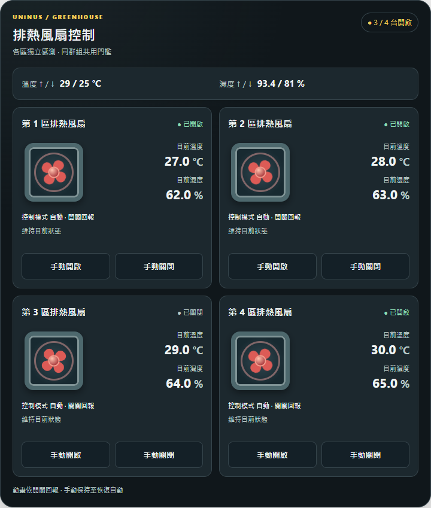

# UNiNUS Greenhouse Fan

Home Assistant custom integration and Lovelace card based on the approved **C 方案 · 逐欄自動排列 v8** design. **Development build only: not released, installed, or verified on a live Home Assistant instance.**



## Implemented in this branch

- A collapsible global policy strip stays **above** independent fan cards at every width; collapsed content shows the shared temperature and humidity on/off limits.
- Grid auto-fit depends on the card's own width. Four items yield 1, 2, 3+1, then 4 in a row. Fixed one/two columns remain available. [1080px three-column screenshot](docs/assets/actual-card-1080.png).
- Each card item has a fan output Entity (`fan.*` or relay `switch.*`), display name, temperature Entity, and humidity Entity. The last two are edited in the **card editor**, not in Integration Options.
- A versioned authoritative binding registry is persisted per integration config entry. The editor's explicit **套用感測來源** action commits a binding through admin-only WebSocket; a Lovelace Save alone only changes display configuration. Conflicts retain the draft. Multiple cards read the same mapping.
- Integration Options contains only shared temperature/humidity on/off thresholds and duration. A periodic controller enforces the same duration on every evaluation, handles unavailable readings fail-closed, and holds manual fan/switch mode across restarts until explicitly resumed.
- The integration bundles and serves the card JavaScript. In Lovelace storage-resource mode it creates/updates its own module resource; YAML-resource mode requires manually declaring the logged module URL.

See the [implementation contract](docs/CONTRACT.md) and [approved offline v8 design](docs/design/v8/SPEC-v8.md). The reference demo is **not** production code.

## Choosing a control group (0.1.1)

1. Add the **UNiNUS Greenhouse Fan** integration in **Settings → Devices & services**, and give each greenhouse control group a recognizable name. Shared thresholds and duration remain in Integration Options.
2. Add the **UNiNUS Greenhouse Fan** dashboard card. The card and visual editor discover control groups automatically—there is no internal ID to copy or type.
3. If exactly one group is loaded, it connects automatically. Otherwise choose the named **控制群組** dropdown. Unloaded groups are shown but cannot be selected. With no groups, use the **Settings → Devices & services** link to add the integration. A failed discovery request is reported as an error, not as “no groups”; retry with **重新讀取綁定** in the editor (the runtime card polls).
4. The editor emits `config-changed` with the selected internal reference; **Save** stores it in the dashboard. Choose fan display items and apply sensor bindings as before. Switching groups retains unsaved sensor drafts separately for each group during that editor session; it never applies those drafts to the other group. Refreshing does not advance a dirty draft’s original revision: use **捨棄草稿並核對來源**, inspect the current backend sources, and edit again to reconcile a conflict before reapplying.

Existing card YAML with `entry_id` continues to work. A saved reference that is missing or unloaded is **never silently switched** to another group; controls stay disabled with a recovery message. Select another loaded group explicitly or repair/reload the original integration. YAML without `entry_id` can resolve the unique loaded group at runtime; with several loaded groups it waits for a named selection. For a durable multi-group choice, select and Save through the visual editor. An already-dispatched backend write cannot be undone by switching or closing the card, but its late result cannot overwrite the new group’s UI/drafts.

Minimal YAML (no manual integration ID):

```yaml
type: custom:uninus-greenhouse-fan-card
name: Greenhouse fans
items:
  - fan_entity: fan.front
    name: Front
layout: auto
theme: dark
```

## Local verification (no HA connection)

```sh
python -m unittest discover -s tests -p 'test_*.py' -v
node --test tests/test_card.mjs
# Requires Playwright and Chromium/Edge:
python tests/verify_card_browser.py
```

The browser harness loads the shipped `www/uninus-greenhouse-fan-card.js`, mocks only HA state/WebSocket, tests widths 390/720/1080/1380px, editor source apply, manual command, named group discovery/selection, missing/unloaded/error states, and lifecycle races. Python adapter tests use explicit HA fakes, **not** a running Home Assistant. `custom_components/uninus_greenhouse_fan/card.js` is a byte-identical bundled copy of the source JS. No physical fan was operated.

## HACS download

Add `https://github.com/ivanlee1007/uninus-greenhouse-fan` as a HACS custom repository with category **Integration**. The root `hacs.json` describes a standard `custom_components/uninus_greenhouse_fan` source installation; no release ZIP is required.

If HACS still selects the old `bbaee59` commit and reports **The version … can not be used with HACS**, refresh the repository information in HACS, reopen Download, and select the latest default-branch commit. That initial commit lacked `hacs.json`; refreshing cannot make the old commit installable. The integration manifest now also includes HACS-required `codeowners` and `issue_tracker` metadata.

This fixes download packaging only; live HA compatibility and physical fan operation still require the safety checks below.

## Installation and safety gate

Do **not** use this initial branch with production fan outputs. Before any installation: review the integration for the target HA version and permissions, verify config flow and Lovelace Add Card GUI in an isolated HA instance, then obtain explicit authorization for a staged live test. Once installed, bound outputs may be automatically controlled under the selected policy; leaving all fans unbound is fail-closed. No release tag, HACS installation, production configuration change, restart, dashboard write, or fan actuation has been performed in this repository work.
